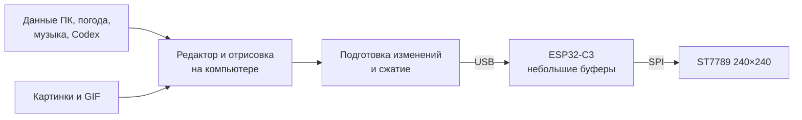

# Мини-дисплей с редактором экранов, GIF и передачей изображения с ПК

Статус реализации на 28 октября 2026: базовый транспорт, редактор, пакет проектов с ресурсами, четыре страницы данных и потоковые GIF реализованы. Палитровое кодирование/RLE, локальные циклы ESP32, необязательный помощник для привилегированных датчиков и аппаратные испытания ещё впереди. Ниже сохранён целевой план; описание возможностей прошивки не означает, что все они уже вошли в текущий протокол. Результаты проверок и ограничения — в [verification.md](verification.md).

## 1. Архитектура

**Основное изображение рисует программа Windows. ESP32 принимает небольшие блоки пикселей и выводит их на ST7789.** Все экраны, исходные картинки и GIF хранятся на ПК; выбранные короткие анимации можно сохранить на устройстве.

Принятые условия: Windows, один USB-кабель для питания и данных, автоматическое переключение страниц и ручное закрепление через программу. Первая версия поддерживает небольшие и полноэкранные GIF; доступная плавность определяется испытанием платы.

## 2. Программа Windows и редактор

Стек: **C# / .NET 10, WPF для интерфейса, SkiaSharp для отрисовки и обработки изображений**. Предпросмотр и устройство получают изображение из одного движка.

- Программа работает в трее, автоматически восстанавливает соединение и предлагает выбор устройства при первом подключении.
- Редактор содержит холст 240×240, слои, перемещение мышью, сетку, текст, системные шрифты с кириллицей, картинки, GIF, шкалы, кольцевые индикаторы и графики.
- GIF можно обрезать, масштабировать, ограничить по частоте кадров и настроить повторение. Прозрачность и восстановление фона между кадрами обрабатываются на ПК.
- Проекты экспортируются пакетом с JSON-описанием и исходными ресурсами. Количество проектов ограничивается свободным местом на компьютере.
- В программе показываются состояние подключения, фактическая частота обновления, поток данных и свободная память устройства.

Начальные страницы и источники:

| Страница | Содержимое |
|---|---|
| Часы и погода | Время, дата, город, температура, ощущаемая температура, влажность и погодная иконка |
| Компьютер | Загрузка CPU/GPU, RAM, доступные температуры и графики |
| Музыка | Название, исполнитель, обложка, состояние воспроизведения и прогресс |
| Codex | Оставшийся процент лимитов и время до сброса |

Погода получается через Open-Meteo раз в 10 минут; источник указывается в виджете. Показатели ПК обновляются раз в секунду через LibreHardwareMonitor; недоступные датчики показываются как «—», для требующих дополнительных прав предусмотрен необязательный помощник. [Open-Meteo](https://open-meteo.com/en/pricing), [LibreHardwareMonitor](https://github.com/LibreHardwareMonitor/LibreHardwareMonitor)

Музыка берётся из медиасессий Windows с выбором источника. Поддерживаются приложения и сайты, передающие сведения в Windows. [Документация Microsoft](https://learn.microsoft.com/en-us/uwp/api/windows.media.control.globalsystemmediatransportcontrolssessionmanager)

Лимиты Codex читаются раз в минуту через локальный App Server методом `account/rateLimits/read`. Учитываются несколько групп лимитов и фактическая длительность окон; отображается `100 − usedPercent`. Данные входа остаются на ПК. [Документация OpenAI](https://learn.chatgpt.com/docs/app-server#6-rate-limits-chatgpt)

## 3. Прошивка и экономия памяти

Стек: **C++ / ESP-IDF, драйвер ST7789 `esp_lcd`, небольшой собственный обработчик изображений**.

Полный кадр постоянно хранить в ESP32 не требуется: контроллер ST7789 удерживает изображение в собственной памяти. Прошивка обновляет нужные области. [Описание ST7789](https://files.seeedstudio.com/wiki/Grove-1.2inch-ips-display/ST7789V_SPEC_V1.2.pdf)

Начальный бюджет памяти:

| Назначение | Бюджет |
|---|---:|
| Два выходных буфера по 16 строк RGB565 | 15 КиБ RAM |
| Очередь принимаемых данных | 16 КиБ RAM |
| Необязательный кэш коротких анимаций | До 64 КиБ RAM |
| Прошивка | Раздел 2 МиБ флеш |
| Сохранённые ресурсы LittleFS | Около 1,9 МиБ флеш |

Остальная RAM нужна системе, обработчикам сообщений и служебным структурам. Кэш анимаций освобождается при нехватке памяти. Текущие кадры, обложки и показатели постоянно во флеш не записываются.

Режимы изображения:

- **RGB565** — основной режим с хорошей цветопередачей.
- **Палитра до 256 цветов** — компактный режим для GIF и пиксельной графики; преобразование в RGB565 выполняется перед выводом.
- **RLE** применяется, только если результат меньше исходных данных.

Программа показывает предпросмотр после преобразования цветов, чтобы результат был виден до загрузки.

## 4. Передача изображения и воспроизведение GIF

**Потоковый режим — основной:** ПК декодирует анимацию, совмещает её с виджетами и отправляет изменения. Продолжительность GIF не ограничивается памятью ESP32.

- Изображение сравнивается с последним подтверждённым кадром и разбивается на блоки 16×16. Соседние изменившиеся блоки объединяются, когда это уменьшает передачу.
- После подключения и смены страницы передаётся полный кадр; затем — изменившиеся области.
- В работе находится один передаваемый кадр и один актуальный ожидающий. Устаревшие ожидающие кадры заменяются свежими.
- Начальный предел — 20 кадров/с; отправка замедляется по подтверждениям устройства. Временная шкала GIF сохраняется, при перегрузке промежуточные кадры пропускаются.

**Локальный режим — для коротких повторяющихся анимаций:** ПК заранее подготавливает палитру, первый полный кадр, изменения и задержки. Ресурс загружается в RAM либо сохраняется во флеш явной командой пользователя.

Локальное воспроизведение используется для отдельной области со статичным фоном. Если поверх неё расположены изменяющиеся виджеты, программа автоматически выбирает потоковый режим. При нехватке места анимация также передаётся потоком.

Протокол версии 1 включает согласование возможностей, начало и завершение кадра, блоки изображения, подтверждения, запрос полного обновления, загрузку и запуск кэша, синхронизацию времени. Сообщения имеют длину, последовательность и CRC32; повреждённые данные не выводятся, после нарушения последовательности запрашивается полный кадр.

Автопереключение: 15 секунд на страницу. Новый трек показывает музыкальную страницу на 10 секунд; закреплённая страница имеет приоритет.

При отсутствии программы более 5 секунд включаются встроенные часы. Вместо них пользователь может выбрать заранее сохранённую полноэкранную анимацию. После полного обесточивания часы ожидают синхронизации.

## 5. Этапы и критерии готовности

1. **Проверка железа и скорости:** уточнить питание и подсветку конкретного модуля, проверить USB, ориентацию, цвета, передачу полных кадров и небольших областей.
2. **Базовая связка:** программа, прошивка, протокол, отрисовка с ПК, переподключение и резервные часы.
3. **Редактор и источники данных:** четыре готовые страницы, сохранение проектов, импорт/экспорт и переключение.
4. **GIF и оптимизации:** корректное декодирование, палитры, сжатие, локальные циклы и автоматический выбор режима.

Проверки готовности:

- GIF с прозрачностью, разными задержками и восстановлением фона выглядит как в предпросмотре.
- Смена страницы останавливает прежние анимации; их кадры не попадают на новый экран.
- Отключение кабеля, сон Windows и прерванная загрузка ресурса не требуют ручной перезагрузки устройства.
- Нехватка памяти приводит к переходу на потоковый режим.
- Отсутствие интернета, датчиков, медиасессии или входа Codex корректно отображается.
- Суточный прогон не показывает утечек памяти, зависаний и накопления задержки.

Wi-Fi, дополнительные кнопки и внешняя карта памяти остаются последующими расширениями. Для первой версии достаточно заказанных ESP32-C3 SuperMini и ST7789.
