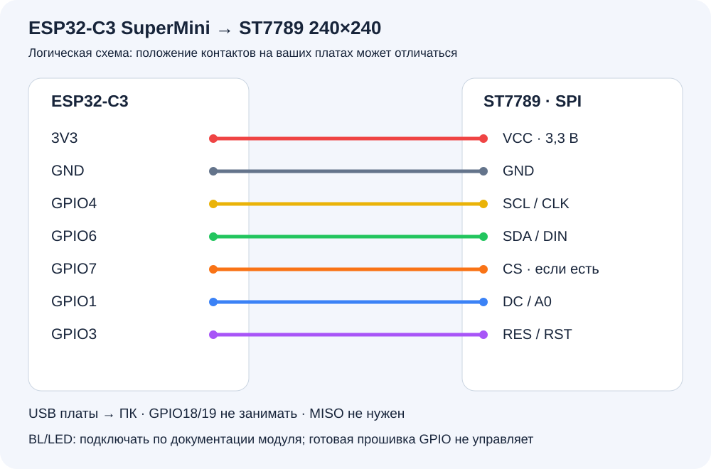

# Display Studio 0.4.0

Программа Windows и прошивка для мини-дисплея на **ESP32-C3 SuperMini + ST7789, 240×240, SPI**.

## С чего начать

1. Распакуйте **весь архив** в постоянную папку, например `C:\DisplayStudio`. Не запускайте программу внутри ZIP.
2. Запустите `Start Display Studio.cmd` либо `App\MiniDisplay.exe`. Установка .NET, Python или ESP-IDF для работы и прошивки не нужна. Требуется Windows 10 версии 2004 / сборки 19041 или новее, x64.
3. Пока платы нет, откройте **Устройство → Эмулятор (без платы) → Подключить**. Страницы можно создавать и проверять на компьютере.
4. Для готового примера нажмите **Открыть** и выберите `Examples\features.mdisplay`.
5. После сборки устройства откройте **Настройки → Прошивка ESP32-C3**, прошейте плату и подключитесь к её COM-порту в разделе **Устройство**.

**Статус комплекта.** Программа и четыре варианта прошивки собраны, формат образов и программные проверки выполнены. Физической платы и дисплея при подготовке не было: питание конкретного модуля, ориентация, подсветка и реальная скорость ещё требуют проверки на устройстве.

## Что лежит в архиве

| Папка или файл | Назначение |
|---|---|
| `Start Display Studio.cmd` | Запуск программы |
| `App` | Программа со всеми необходимыми библиотеками |
| `App\Firmware` | Готовые BIN-файлы и описание вариантов для встроенного прошивальщика |
| `App\Tools\esptool` | Официальный esptool для Windows; отдельно устанавливать его не нужно |
| `Firmware` | Копии BIN-файлов, исходный проект ESP-IDF и параметры сборки |
| `Examples` | Примеры проектов с ресурсами |
| `README.html`, `README.txt`, `README.md` | Эта инструкция в удобном формате |
| `SHA256SUMS.txt` | Контрольные суммы файлов комплекта |
| `Licenses` | Лицензии и исходники распространяемого esptool |

Переносите всю папку комплекта. Один EXE без соседних DLL и папок не работает.

## Подключение дисплея

Нужны ESP32-C3 SuperMini с **встроенным USB Serial/JTAG**, флеш-памятью **4 МиБ**, ревизией чипа **0.3 или новее**, ST7789 240×240 с SPI, провода и USB-кабель с передачей данных. ESP32, ESP32-S3/C6, SSD1306, ILI9341, круглые GC9A01 и дисплеи другого разрешения этим комплектом не поддерживаются. Wi-Fi не используется.

Подключайте провода при **отсоединённом USB**. Сверяйте надписи на платах, а не положение контакта на фотографии: у разных производителей SuperMini и ST7789 разная разводка. Таблица ниже совпадает с готовыми BIN-файлами.

| Контакт дисплея | Контакт ESP32-C3 | Что это |
|---|---|---|
| `GND` | `GND` | Общая земля |
| `VCC` | `3V3` | Только для модуля, допускающего питание 3,3 В |
| `SCL`, `SCK` или `CLK` | `GPIO4` | Тактовый сигнал SPI |
| `SDA`, `DIN` или `MOSI` | `GPIO6` | Данные SPI |
| `CS`, если есть | `GPIO7` | Выбор дисплея |
| `DC`, `D/C` или `A0` | `GPIO1` | Команда / данные |
| `RES`, `RST` или `RESET` | `GPIO3` | Сброс дисплея |
| `BL`, `BLK` или `LED` | По схеме вашего модуля | Подсветка, см. ниже |



Надписи SCL/SDA здесь обозначают **SPI**, а не I²C. Линия MISO от дисплея не нужна. GPIO18/19 заняты USB и к дисплею не подключаются. GPIO2/8/9 связаны с загрузкой чипа; в готовой схеме они не используются.

Если на семиконтактном модуле нет CS, оставьте GPIO7 неподключённым: такая панель должна быть рассчитана производителем на постоянно выбранный SPI-интерфейс.

**Питание и подсветка.** Логические сигналы ESP32-C3 — 3,3 В, подавать на GPIO 5 В нельзя. Таблица предполагает модуль ST7789, совместимый с питанием 3,3 В. Если на вашем модуле указан только другой способ питания, сначала сверьтесь с его документацией. Контакт BL/LED нельзя автоматически считать обычным логическим входом: он бывает входом управления или питанием светодиодов. Подключайте его к 3V3 только если производитель разрешает такое подключение и на модуле есть необходимое ограничение тока/драйвер. Для голой подсветки нужен внешний драйвер. Готовая прошивка **не управляет подсветкой через GPIO**; её контакт в конфигурации равен -1. Не питайте мощную подсветку прямо от GPIO.

Для отладки используйте короткие провода. Питание ESP32 поступает через USB платы; не подавайте одновременно отдельное питание без понимания схемы конкретной платы.

## Первая прошивка из программы

1. Подключите плату USB-кабелем с передачей данных. Закройте Serial Monitor, Arduino IDE, ESP-IDF Monitor и другие программы, занявшие этот COM-порт.
2. Для первого входа в загрузчик удерживайте **BOOT**, кратко нажмите **RESET/RST**, затем отпустите BOOT. Если RESET нет, удерживайте BOOT при подключении USB.
3. Откройте **Настройки** в Display Studio. В карточке **Прошивка ESP32-C3** нажмите **Обновить** и выберите COM-порт платы. Определить его можно сравнением списка до и после подключения USB или в диспетчере устройств Windows.
4. Выберите **Стандартный ST7789**. Остальные варианты нужны только для смещения изображения или перепутанных красного/синего каналов.
5. Нажмите **Прошить ESP32-C3**, проверьте порт и подтвердите замену прошивки. Программа освободит своё соединение с дисплеем и проверит целостность файлов. Старая прошивка и настройки платы в записываемой области будут заменены.
6. Не отключайте USB до сообщения об успехе. Ход работы доступен в **Журнале прошивки**. Если прервать запись, переведите плату в BOOT и прошейте заново.
7. Если после прошивки плата осталась в загрузчике, нажмите RESET. При необходимости обновите список COM-портов: номер может измениться.
8. Откройте **Устройство**, выберите COM-порт платы и нажмите **Подключить**. Затем выберите страницу в разделе **Показ**.

На Windows 10/11 встроенный USB Serial/JTAG обычно определяется системным драйвером при подключении к интернету. Если COM-порта нет, используйте [официальную инструкцию Espressif](https://docs.espressif.com/projects/esp-techpedia/en/latest/esp-friends/get-started/try-firmware/try-firmware-usb-driver.html). Прошивка работает именно через встроенный USB ESP32-C3; наличие внешнего CH340/CP210x вместо нужного USB-разъёма не заменяет его.

### Как выбрать вариант дисплея

| Вариант | Когда выбирать | Файл |
|---|---|---|
| Стандартный ST7789 | Первая попытка; начало картинки без смещения | `st7789-y0.bin` |
| Смещение 80 строк | После стандартного варианта картинка сдвинута/обрезана по вертикали | `st7789-y80.bin` |
| Красный и синий поменяны | Геометрия верная, но красный и синий перепутаны | `st7789-y0-bgr.bin` |
| Смещение 80 строк + замена цветов | Нужны обе коррекции | `st7789-y80-bgr.bin` |

У всех вариантов одинаковые контакты, SPI 20 МГц и включённая инверсия ST7789. Для проверки выберите страницу **Проверка цветов**: полосы должны идти красная, зелёная, синяя, белая. Не меняйте проводку RGB/BGR — это параметр контроллера. Для иной ориентации, инверсии или нестандартного модуля потребуется настройка исходной прошивки; готовые варианты не обещают совместимость со всеми панелями с надписью ST7789.

## Программа и повседневная работа

- **Показ:** клик по странице слева сразу переключает дисплей. Без автосмены она остаётся на экране; с автосменой после её интервала появится следующая.
- **Редактор:** выбор страницы и редактирование не вмешиваются в показ. Элементы добавляются кнопкой «Добавить элемент». Изображения, GIF, текст, часы, шкалы, кольца и графики редактируются справа.
- **Размер картинок:** выделите изображение и тяните маркеры рамки. Углы сохраняют пропорции, Shift даёт свободный размер; стороны меняют ширину или высоту. Внутри рамки объект перемещается. Ctrl+Z отменяет один жест.
- **Свойства страницы:** нажмите страницу в списке ещё раз или пустое место самого холста. Справа будут фон, название и время показа.
- **Данные:** город погоды, медиасессия Windows и группа лимитов Codex. Недоступные датчики или источники обозначаются «—». Часть температур без дополнительных прав может быть недоступна.
- **Настройки:** автозагрузка, восстановление проекта, подключение к последнему устройству, прошивка и эта инструкция.

Сохраните проект через Ctrl+S в `.mdisplay`: в одном файле будут страницы, настройки источников, картинки и GIF. При переносе на другой компьютер достаточно проекта и полного комплекта программы. Пути к исполняемым файлам, пароли и токены Codex в проект не включаются. Лимиты Codex требуют установленного и уже авторизованного Codex; Display Studio не выполняет вход за пользователя и не делает запросов к модели.

В «Показе» и редакторе предпросмотр чёткий, с учётом размера окна. Физическая панель и принятый кадр эмулятора имеют реальное разрешение **240×240 RGB565**. GIF декодируется на компьютере и передаётся потоком; его плавность зависит от реальной платы и соединения.

## Автозагрузка и работа в трее

Сначала выберите постоянную папку программы и сохраните проект. Затем в **Настройки → Запуск программы** включите **Запускать Display Studio при входе в Windows**. Прав администратора не требуется; настройка действует для текущего пользователя.

При следующем входе приложение появится в трее, возле системных часов. Если включены соответствующие флажки, оно откроет последний **сохранённый** проект и начнёт подключение к последнему успешно использованному COM-порту или эмулятору. При временном отсутствии платы программа повторяет подключение. Несохранённые изменения не заменяют сохранённый проект: нажимайте Ctrl+S перед выключением компьютера.

Двойной клик по значку в трее открывает окно. Крестик сворачивает в трей. **Для полного завершения** выберите «Выход из приложения» в меню ⋯ или меню значка. Повторный запуск программы открывает уже работающее окно. При прошивке выход блокируется до завершения или отмены записи.

Если папка программы перенесена, включите автозагрузку заново из новой копии. Если запуск отключён средствами Windows, проверьте **Параметры → Приложения → Автозагрузка**. Для удаления программы сначала снимите её галочку автозагрузки и завершите приложение, затем удалите папку. Ваши проекты хранятся там, куда вы их сохранили; локальные настройки — в `%LOCALAPPDATA%\MiniDisplay\settings.json`.

## Если что-то не работает

| Симптом | Что проверить |
|---|---|
| Нет COM-порта | Кабель с данными, другой USB-порт, BOOT+RESET, диспетчер устройств и официальный драйвер. Кнопка «Обновить» перечитывает список. |
| Порт занят | Отключите соединение в другой копии программы; закройте мониторы порта и IDE. Встроенный прошивальщик освобождает только порт своей копии. |
| esptool не подключается | Правильный COM; повторите вход в BOOT; затем запустите прошивку. |
| Прошивка прервана | Не отключая питание, снова войдите в BOOT и повторите запись целиком. |
| Плата не запускает образ | Требуется ESP32-C3, 4 МиБ, ревизия 0.3+. Другие семейства ESP32 не подходят. Ошибка чипа/ревизии видна в журнале. |
| Подсветка тёмная | Питание и контакт BL по схеме модуля; подсветка не включается программой через GPIO. |
| Подсветка есть, изображения нет | GND/VCC, DC/RESET/SPI, реальная модель ST7789 и разрешение 240×240. Проверьте подписи контактов. |
| Картинка сдвинута по вертикали | Попробуйте вариант со смещением 80 строк. |
| Красный и синий перепутаны | Выберите соответствующий вариант цветов и перепрошейте. |
| Цвета выглядят негативом / изображение зеркальное | Конкретному модулю нужна другая инверсия/ориентация; настройте исходный проект ESP-IDF. |
| Ошибка целостности комплекта | Распакуйте полный архив заново в новую папку; не перемешивайте файлы разных версий. |
| В погоде «—» | Выберите город в «Данных» и проверьте интернет. При отказе Open-Meteo используется MET Norway, оба запроса выполняются по HTTPS. |
| Музыка или обложка не появляются | Проигрыватель должен передавать сведения в медиасессию Windows; выберите его в «Данных». |
| Codex показывает «—» | Установлен ли Codex, выполнен ли вход, найден ли codex.exe и доступна ли выбранная группа лимитов. |

После нескольких секунд без программы прошивка показывает резервные часы. До первой синхронизации и после полного обесточивания вместо точного времени будут прочерки. Точное время появляется после подключения Display Studio. Сохранённых локальных GIF, Wi-Fi, палитрового кодирования и RLE в этой версии ещё нет.

## Исходная прошивка и самостоятельная сборка

Обычному пользователю этот раздел не нужен: готовые BIN-файлы уже встроены в программу.

В `Firmware\source.zip` находится проект **ESP-IDF v5.5**, контакты задаются в **Mini Display ST7789** через `idf.py menuconfig`. Разместите исходники в папке без пробелов и кириллицы, например `C:\EspProjects\display`. После установки официального ESP-IDF откройте его PowerShell и выполните:

```text
cd C:\EspProjects\display
idf.py set-target esp32c3
idf.py menuconfig
idf.py build
idf.py merge-bin
```

Объединённый `build\merged-binary.bin` записывается **с адреса 0x0**. Отдельные файлы: загрузчик 0x0, таблица разделов 0x8000, приложение 0x10000. Встроенный прошивальщик принимает только проверенные варианты текущего комплекта, а не произвольные пользовательские BIN. Собственный образ загружается средствами ESP-IDF/esptool. Скрипт `build-firmware.ps1` в исходном комплекте собирает четыре штатных варианта в настроенном окружении ESP-IDF.

Исходники ESP-IDF: [v5.5](https://github.com/espressif/esp-idf/tree/v5.5), esptool: [v5.6.0](https://github.com/espressif/esptool/tree/v5.6.0). Лицензии программы и сторонних компонентов находятся в `App\licenses`, `App\THIRD-PARTY.md` и `Licenses`.

Официальные справочники: [USB и BOOT для ESP32-C3](https://docs.espressif.com/projects/esp-idf/en/v5.5/esp32c3/get-started/establish-serial-connection.html), [SPI LCD ESP-IDF](https://docs.espressif.com/projects/esp-idf/en/v5.5/esp32c3/api-reference/peripherals/lcd/spi_lcd.html), [питание ESP32-C3](https://docs.espressif.com/projects/esp-hardware-design-guidelines/en/latest/esp32c3/schematic-checklist.html). Таблица проводов выше относится к прошивке этого комплекта; документация конкретного модуля имеет значение для питания и подсветки.
